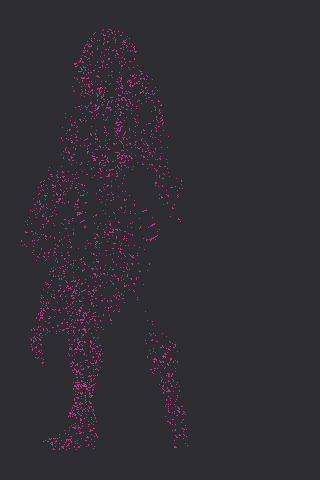
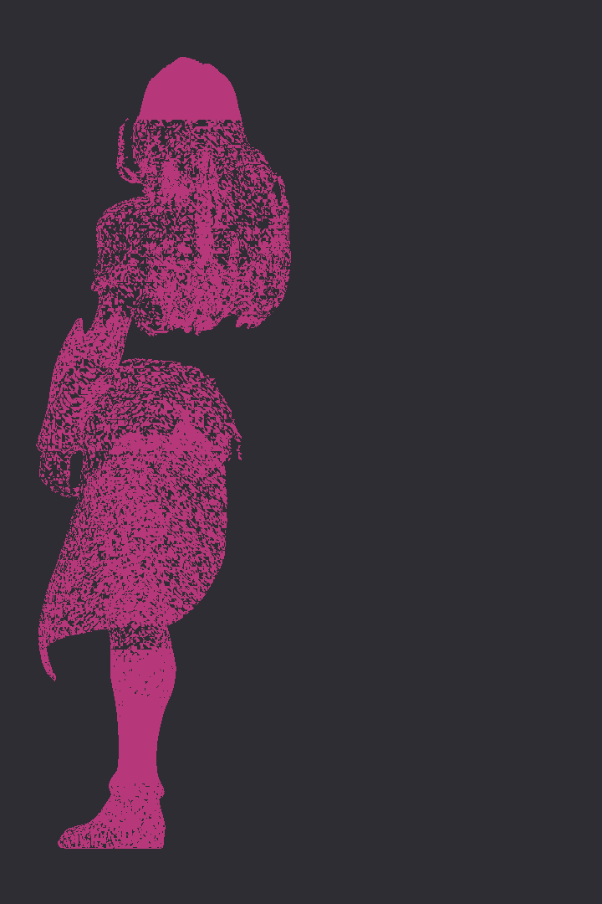

# Animation-Skeleton

**关节一致的运动桥接**：不同外形的 mesh 在对齐到共享 53 骨语义后，用 **同一 FK + LBS 路径** 响应语言或 motion JSON。

```
pip install -e .
worldmix-animate mesh.glb --batched-preview --max-faces 48000 --front-only
```

---

## 运行结果（Diane，全 mesh 27 万面）

LBS 在 **全顶点** 上计算；预览用 **正面外层壳 + 分 batch 光栅**（48k 三角面预算，与关节运动帧帧一致）。

| 动画 `walk forward` | T-pose（对齐后） |
|---------------------|------------------|
|  |  |

- 全 mesh：**272 656** 三角面  
- 预览：**48 000** 面（外层深度壳 + 高度分层采样）  
- 光栅：**8192** 三角面 / batch，深度排序后分批写入同一 z-buffer（无全图邻接表）  
- `motion_check.same_pipeline: true` — 与标准骨模板 **同一 `pose_skeleton_frames`**

---

## 方法原理

**问题**：动作写在关节上；若每个资产生成不同骨骼拓扑，动作库无法迁移。

**做法**（不是「播放固定模板 mesh」）：

1. **关节语义全局共享** — 53 骨 hierarchy 固定；指令与 JSON 始终在同一关节空间定义。  
2. **比例 retarget** — ViT 正面显著性 + 几何 landmark 估计主要关节，**只缩放骨长** 拟合当前 GLB。  
3. **闭合运动链** — 语言 / JSON → 骨旋转 → FK → 全顶点 LBS。  
4. **稠密表面可扩展预览** — 与大规模点云处理相同思想：**分块推进**  
   - 变形：全顶点一次 LBS（batch 在关节维，不受面数限制）  
   - 绘制：外层可见三角面深度排序，按 `raster_batch` 分批光栅，避免构建 \(O(F)\) 邻接并在 CPU 上稳定跑通 20 万+ 面级资产  

**创新点在于关节一致性**：拓扑与 FK 路径不变，外观通过对齐与蒙皮接入；预览 batch 只影响成像成本，不改变关节运动。

---

## 安装

```bash
git clone https://github.com/Rayana-AD/Animation-Skeleton.git
cd Animation-Skeleton
python -m venv .venv && source .venv/bin/activate
pip install -e ".[dev]"
export PYTORCH_ENABLE_MPS_FALLBACK=1   # Apple Silicon
```

### 复现主页动画

```bash
worldmix-animate outputs/model_diane/shape.glb \
  --output outputs/shell_diane \
  --command "walk forward" \
  --frames 16 --fps 8 \
  --batched-preview \
  --max-faces 48000 \
  --raster-batch 8192 \
  --outer-keep 0.75 \
  --front-only \
  --panel-width 720 --panel-height 1080
```

Python：

```python
from worldmix.character.glb_standard_overlay import build_glb_shell_on_standard_skeleton, save_front_shell_animation
from worldmix.character.motion_adapter import text_command_to_motion

shell = build_glb_shell_on_standard_skeleton("mesh.glb")
motion = text_command_to_motion("walk forward", frames=16)
save_front_shell_animation(
    shell,
    "out/walk.gif",
    motion_sequence=motion,
    max_faces=48000,
    batched_raster=True,
    triangle_batch=8192,
    panel_width=720,
    panel_height=1080,
)
```

| CLI | 作用 |
|-----|------|
| `worldmix-animate` | 对齐 + LBS + GIF / JSON |
| `worldmix-language-avatar` | 关节空间语言运动可视化 |
| `worldmix-align-study` | 对齐 / 蒙皮参数扫描（`pip install -e ".[study]"`） |

---

## 代码索引

| 模块 | 职责 |
|------|------|
| `vit_align.py` | 关节预测、比例 retarget |
| `glb_standard_overlay.py` | Shell、`batched_raster` 动画导出 |
| `mesh_rasterize.py` | `rasterize_ortho_batched` 分 batch 光栅 |
| `mesh_shell_skinning.py` | LBS、`select_render_triangles` |
| `motion_adapter.py` | 语言 → 逐帧关节旋转 |
| `standard_skeleton_gaussians.py` | 53 骨 rest 与 FK |

---

## English

**Joint-consistent motion bridge** for dense generative meshes: retarget proportions onto a shared 53-bone hierarchy, drive **identical FK + LBS** from text or JSON, and preview on **hundreds of thousands of triangles** via **outer-shell face selection + depth-sorted batch rasterization** (48k-face showcase on a 273k-face GLB).
