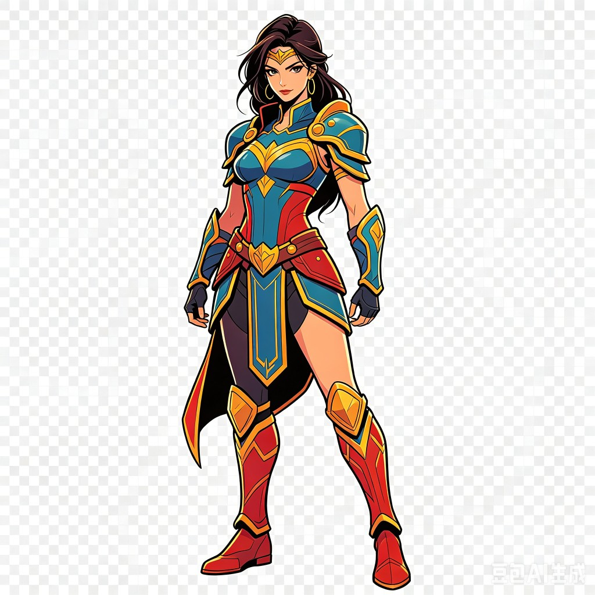

# Animation-Skeleton

把 **自然语言（或 motion JSON）** 实时变成人物姿态，同时让 **不同外形的 mesh 共用同一套关节语义**——动作只写一次，换资产不必重绑拓扑。

```bash
pip install -e .
worldmix-animate outputs/model_diane/shape.glb --command "walk forward" --max-faces 6000 --front-only
```

---

## 背景：语言驱动姿态，难在关节一致

**语言实时驱动**在这里指：用户改一句指令（如 `walk forward` → `wave hello`），管线 **只重算关节旋转序列**，不需要对当前 GLB 重新做骨骼拓扑拟合或再训练。实现上依赖「动作住在关节里，mesh 跟着关节走」。

**关节一致性**是更难的一层：

| 若不一致 | 后果 |
|----------|------|
| 每个 mesh 各有一套骨名 / 父子关系 | 同一 JSON、同一语言模板无法复用 |
| 对齐时改掉 hierarchy | FK 链断裂，LBS 权重语义漂移 |
| mesh 变形与标准骨 FK 走不同代码路径 | 「看起来在动」但无法验证运动是否同一套 |

本仓库做法是：**53 骨 hierarchy 全局固定** → 对新 GLB **只调骨长与根位移** → 所有指令与 JSON 都进入 **同一条** `pose_skeleton_frames` → `skin_vertices` 链。换语言 = 换pose字典序列；换 mesh = 换对齐与蒙皮，**不改关节索引空间**。

**资产从哪来**：主页 demo 使用静态 **GLB**（`outputs/model_diane/shape.glb`，由概念图生成 mesh）。中间也可来自其它表面管线（例如点云抛光后再导出 GLB）；**进入本仓库后统一按 GLB 处理**，动画阶段不区分来源。

---

## 运行结果（当前主展示）

预览参数：`--max-faces 6000 --front-only`（稳定光栅，非实验 batched 路径）。

| 指令 `walk forward`（关节 + LBS） | 输入概念图 → shape GLB |
|-----------------------------------|-------------------------|
|  |  |

右侧为生成用参考图；mesh 为 `shape.glb`（约 27 万三角面）。左侧动图在 **全顶点 LBS** 下得到，仅绘制时采样子集三角面。

> **说明**：`aligned_rest_shell_front.png` 在开启高面数 batched 预览时曾出现碎面/镂空，属 **绘制子集** 问题而非 rest 骨骼错误；T-pose 展示暂用概念图 + GLB 路径说明。稠密 batched 预览见 [docs/BATCHED_DENSE_PREVIEW.md](docs/BATCHED_DENSE_PREVIEW.md)（实验、无主页结果）。

---

## 方法：从指令到 mesh，为何可「实时改」且「一致」

### 总览（对应 `worldmix/cli/animate.py`）

```
shape.glb
  → align_glb_to_standard_skeleton()     # vit_align.py
  → compute_vertex_skin_weights()        # glb_skeleton_fit.py（对齐后做一次）
  → text_command_to_motion(command)      # motion_adapter.py（改指令只到这里）
  → 每帧: pose_skeleton_frames → skin_vertices → 光栅
```

### 1. 语言 → 关节旋转序列（可实时改）

`text_command_to_motion` 按指令选模板，在 **固定骨名** 上生成每帧 `dict[bone_name, 3×3 rotation]`：

```476:481:worldmix/character/motion_adapter.py
def text_command_to_motion(
    command: str,
    frames: int = 24,
) -> list[dict[str, np.ndarray]]:
    """Rule-based language-to-motion baseline for smoke E2E validation."""
    return render_action_template(select_action_template(command), frames=frames)
```

改 `command` 只替换 `motion_sequence`，**不**重新跑 ViT / 蒙皮。JSON 运动同理：`load_motion_json` 直接注入同名格式的序列。

### 2. 对齐：变比例，不变拓扑（一次性 per GLB）

`retarget_skeleton_proportions` 复制模板骨列表，按 mesh 关节距离 **缩放骨段**，再保持 parent→child 头尾衔接；name / parent 与模板一致：

```228:238:worldmix/character/vit_align.py
def retarget_skeleton_proportions(
    template_bones: list[StandardBone],
    mesh_joints: dict[str, np.ndarray],
) -> tuple[list[StandardBone], dict[str, float]]:
    """Scale standard bone lengths to ViT mesh proportions; topology unchanged."""
    template_joints = skeleton_joint_targets(template_bones)
    scales = compute_proportion_scales(template_joints, mesh_joints)

    bones: list[StandardBone] = [
        StandardBone(b.name, b.parent, b.head.copy(), b.tail.copy(), b.radius) for b in template_bones
    ]
```

### 3. 单一 FK 路径（一致性的核心）

动画每帧调用 `pose_skeleton_frames`，内部与 `pose_avatar` 共用 `RiggedGaussianAvatar` FK：

```48:59:worldmix/character/mesh_shell_skinning.py
def pose_skeleton_frames(
    bones: list[StandardBone],
    pose: dict[str, np.ndarray] | None = None,
) -> tuple[list[np.ndarray], list[np.ndarray]]:
    """Evaluate posed bone heads and local frames (same hierarchy as pose_avatar)."""
    avatar = RiggedGaussianAvatar(bones=bones, gaussians=[])
    _, segments = pose_avatar(avatar, pose)
    heads = [head.copy() for head, _ in segments]
    frames: list[np.ndarray] = []
    for bone, (head, tail) in zip(bones, segments):
        frames.append(_axis_frame(head, tail))
    return heads, frames
```

`verify_motion_path_matches_standard`（`glb_standard_overlay.py`）对比 retarget 后骨骼与模板 avatar 的 FK 输出，`max_head_delta < 1e-9` 即 `same_pipeline: true`。

### 4. 全顶点 LBS（外观挂接在关节上）

```62:88:worldmix/character/mesh_shell_skinning.py
def skin_vertices(
    vertices: np.ndarray,
    rest_heads: list[np.ndarray],
    rest_frames: list[np.ndarray],
    posed_heads: list[np.ndarray],
    posed_frames: list[np.ndarray],
    bone_indices: np.ndarray,
    weights: np.ndarray,
) -> np.ndarray:
    """Linear blend skinning in bone-local coordinates."""
    ...
        local = np.einsum("nij,nj->ni", np.transpose(rest_f, (0, 2, 1)), vertices - rest_h)
        posed = pose_h + np.einsum("nij,nj->ni", pose_f, local)
        out += w[:, None] * posed
    return out
```

顶点数可以是 9 万、27 万；**蒙皮成本随顶点数增长，与当前语言指令无关**。预览 GIF 可用 `max_faces` 只减 **绘制三角面**，不改变上述 LBS 结果。

---

## 复现主页动图

```bash
git clone https://github.com/Rayana-AD/Animation-Skeleton.git
cd Animation-Skeleton
python -m venv .venv && source .venv/bin/activate
pip install -e ".[dev]"
export PYTORCH_ENABLE_MPS_FALLBACK=1

worldmix-animate outputs/model_diane/shape.glb \
  --output outputs/shell_diane \
  --command "walk forward" \
  --frames 12 --fps 8 \
  --max-faces 6000 \
  --front-only \
  --panel-width 320 --panel-height 480
```

换指令（实时改姿态，无需重新对齐）：

```bash
worldmix-animate outputs/model_diane/shape.glb \
  --output outputs/wave_demo \
  --command "wave hello" --frames 12 --max-faces 6000 --front-only
```

---

## 实验模块：稠密 mesh 分 batch 光栅

高面数 **绘制** 实验代码已合入（`rasterize_ortho_batched`、`--batched-preview`），用于探索 20 万+ 面预览；**标定与视觉验收未完成**，故未作为主页结果。设计与 API 见 **[docs/BATCHED_DENSE_PREVIEW.md](docs/BATCHED_DENSE_PREVIEW.md)**。

---

## 脚本与模块索引

| 步骤 | 脚本 / 符号 | 文件 |
|------|-------------|------|
| CLI 入口 | `worldmix-animate` | `worldmix/cli/animate.py` |
| 对齐 | `align_glb_to_standard_skeleton` | `vit_align.py` |
| 蒙皮权重 | `compute_vertex_skin_weights` | `glb_skeleton_fit.py` |
| 语言运动 | `text_command_to_motion` | `motion_adapter.py` |
| 导出 GIF | `save_front_shell_animation` | `glb_standard_overlay.py` |
| 分 batch 光栅（实验） | `rasterize_ortho_batched` | `mesh_rasterize.py` |

---

## English (short)

**Language-driven poses on a shared 53-bone kinematic space**: text or JSON only replaces the per-frame joint rotation sequence; mesh alignment and skin weights are amortized per asset. **Joint consistency** is enforced by fixed topology, proportion-only retargeting, and a single FK + LBS path verified by `verify_motion_path_matches_standard`. Homepage demo uses stable 6k-face preview; batched dense raster is documented separately and not yet promoted to README figures.
